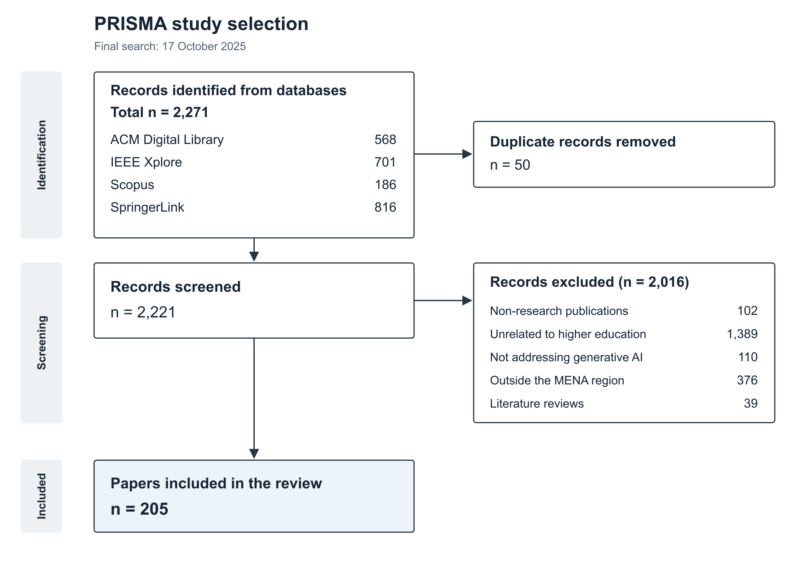

# Generative AI in Higher Education in the MENA Region

Companion repository for *Generative AI in Higher Education in the MENA Region: A Maturity-Based Perspective*, by Omar Amrani Nejjar, Abdelghafour Aboukacem, and Ismail Berrada.

The [Excel workbook](data/Papers.xlsx) contains **205 papers**. This README presents the methodology and explains how to find papers supporting each chapter section.

## Methodology

### Search scope

The review covers **January 2020–17 October 2025**. The final searches were conducted on **17 October 2025**.

Searches combined four concepts using **AND**:

- Generative AI
- Higher education
- Educational activities
- MENA countries

Alternative terms within each concept were connected using **OR**.

### Inclusion and exclusion criteria

| Criterion | Include | Exclude |
| --- | --- | --- |
| Topic | Research addressing generative AI use, adoption, or evaluation. | Studies not addressing generative AI. |
| Educational context | Higher education, including teaching, learning, assessment, and scholarly activities. | Studies unrelated to higher education, including primary/secondary-only studies and technical model development without a higher education application. |
| Geography | Studies concerning higher education in the MENA region. | Studies outside the MENA region. |
| Publication type | Research publications. | Non-research publications and literature reviews. |

### Databases and search settings

| Database | Search fields and filters | Records |
| --- | --- | ---: |
| ACM Digital Library | Full text; research articles; E-Publication Date from 1 January 2022. | 568 |
| IEEE Xplore | Full text. | 701 |
| Scopus | Title, abstract, keywords; four query boxes connected by AND. | 186 |
| SpringerLink | Research articles and articles. | 816 |
| **Total** | | **2,271** |

The ACM search used a 2022-onward publication filter within the review’s overall 2020–2025 scope.

<details>
<summary>ACM Digital Library search string</summary>

```text
[[Full Text: "generative artificial intelligence"] OR [Full Text: "generative ai"] OR [Full Text: "large language model"] OR [Full Text: "chatgpt"] OR [Full Text: "gpt-4"] OR [Full Text: "foundation model"] OR [Full Text: "generative model"]]
AND
[[Full Text: "higher education"] OR [Full Text: "university"] OR [Full Text: "college"] OR [Full Text: "tertiary education"] OR [Full Text: "postsecondary"]]
AND
[[Full Text: "teaching"] OR [Full Text: "learning"] OR [Full Text: "assessment"] OR [Full Text: "pedagogy"] OR [Full Text: "curriculum"] OR [Full Text: "academic integrity"] OR [Full Text: "student performance"] OR [Full Text: "faculty"] OR [Full Text: "education technology"]]
AND
[[Full Text: "middle east"] OR [Full Text: "gcc"] OR [Full Text: "north africa"] OR [Full Text: "mena"] OR [Full Text: "morocco"] OR [Full Text: "algeria"] OR [Full Text: "tunisia"] OR [Full Text: "egypt"] OR [Full Text: "libya"] OR [Full Text: "lebanon"] OR [Full Text: "jordan"] OR [Full Text: "qatar"] OR [Full Text: "kuwait"] OR [Full Text: "oman"] OR [Full Text: "saudi arabia"] OR [Full Text: "united arab emirates"] OR [Full Text: "uae"] OR [Full Text: "bahrain"] OR [Full Text: "iraq"]]
AND
[E-Publication Date: (01/01/2022 TO *)]
```

</details>

<details>
<summary>IEEE Xplore search string</summary>

```text
("generative artificial intelligence" OR "generative AI" OR "large language model" OR "ChatGPT" OR "GPT-4" OR "foundation model" OR "generative model")
AND
("higher education" OR "university" OR "college" OR "tertiary education" OR "postsecondary")
AND
("teaching" OR "learning" OR "assessment" OR "pedagogy" OR "curriculum" OR "academic integrity" OR "student performance" OR "faculty" OR "education technology")
AND
("Middle East" OR "GCC" OR "North Africa" OR "MENA" OR "Morocco" OR "Algeria" OR "Tunisia" OR "Egypt" OR "Libya" OR "Lebanon" OR "Jordan" OR "Qatar" OR "Kuwait" OR "Oman" OR "Saudi Arabia" OR "United Arab Emirates" OR "UAE" OR "Bahrain" OR "Iraq")
```

</details>

<details>
<summary>SpringerLink search string</summary>

```text
("generative artificial intelligence" OR "generative AI" OR "large language model" OR "ChatGPT" OR "GPT-4" OR "foundation model" OR "generative model")
AND
("higher education" OR "university" OR "college" OR "tertiary education" OR "postsecondary")
AND
("teaching" OR "learning" OR "assessment" OR "pedagogy" OR "curriculum" OR "academic integrity" OR "student performance" OR "faculty" OR "education technology")
AND
("Middle East" OR "GCC" OR "North Africa" OR "MENA" OR "Morocco" OR "Algeria" OR "Tunisia" OR "Egypt" OR "Libya" OR "Lebanon" OR "Jordan" OR "Qatar" OR "Kuwait" OR "Oman" OR "Saudi Arabia" OR "United Arab Emirates" OR "UAE" OR "Bahrain" OR "Iraq")
```

</details>

<details>
<summary>Scopus: four query boxes connected by AND</summary>

Select **Title, abstract, keywords** for each box and connect the four boxes using **AND**.

**Box 1 — Generative AI**

```text
"generative artificial intelligence" OR "generative AI" OR "large language model" OR "ChatGPT" OR "GPT-4" OR "foundation model" OR "generative model"
```

**Box 2 — Higher education**

```text
"higher education" OR "university" OR "college" OR "tertiary education" OR "postsecondary"
```

**Box 3 — Educational activities**

```text
"teaching" OR "learning" OR "assessment" OR "pedagogy" OR "curriculum" OR "academic integrity" OR "student performance" OR "faculty" OR "education technology"
```

**Box 4 — MENA**

```text
"Middle East" OR "GCC" OR "North Africa" OR "MENA" OR "Morocco" OR "Algeria" OR "Tunisia" OR "Egypt" OR "Libya" OR "Lebanon" OR "Jordan" OR "Qatar" OR "Kuwait" OR "Oman" OR "Saudi Arabia" OR "United Arab Emirates" OR "UAE" OR "Bahrain" OR "Iraq"
```

</details>

### Study selection and PRISMA diagram

The searches identified **2,271 records**. Removing **50 duplicates** left **2,221 records** for screening. Of these, **2,016 were excluded**, leaving **205 papers** for analysis.



### Data extraction and synthesis

Each paper was characterized by its geographical and educational context, discipline, GenAI tools and applications, research design, participants, findings, barriers, enablers, future research directions, and impact/evidence.

Documented adoption practices were classified using the five-stage maturity model. Counts describe papers rather than institutions. Reported benefits and concerns are interpreted alongside the research design and strength of evidence.

## How to filter the workbook

Open **Cleaned Short List** and use the dropdowns in **row 3**.

- Select exact values for categories.
- Use **Text Filters → Contains** for keywords.
- Use **Data → Clear** before starting a new search.
- Follow **URL (C)** to access a paper.

Search alternative keywords separately and combine papers without duplicates. Filters on different columns require both conditions to match.

The counts below are the chapter’s reported results. Keyword searches locate relevant papers but may return different totals from the chapter’s thematic coding. Read **Findings (S)** and **Impact & Evidence (X)** to interpret each result.

## 1. Introduction

Use the full workbook for the regional overview. Read **AI Use Case (L)**, **Findings (S)**, and **Barriers (T)** for applications, benefits, and concerns.

Narrow by **Country (D)** or **Discipline (G)** when exploring a specific context.

## 2. Foundations

| Subsection | How to find the relevant papers |
| --- | --- |
| **2.1. Understanding Generative AI** | Search **Tools used (J)** for `ChatGPT`, `Gemini`, `Copilot`, or `Claude`. Use **Modality (K)** to distinguish text and other applications. |
| **2.2. Gathering the Evidence** | Clear all filters to view all **205 papers**. Filter **Year (B)** to select 2023, 2024, or 2025. |
| **2.3. A Maturity Scale for Universities** | Filter **Maturity (V)** using the labels below. Read **Deployment (M)** and **Integrations (N)** for implementation context. |

## 3. Analysis

### 3.1. How Far Have Universities Gone?

Most studies document individual exploration or small pilots.

| Select in Maturity (V) | Papers |
| --- | ---: |
| `Awareness/Exploration` | 122 (59.5%) |
| `Experimentation/Pilots` | 74 (36.1%) |
| `Integration/Institutionalization` | 9 (4.4%) |

No papers are assigned to Stages 4 or 5. The nine Stage 3 assignments are an upper bound; the chapter identifies only two as clear examples of broader integration.

For publication trends, filter **Year (B)**:

- **2023:** 16 papers
- **2024:** 79 papers
- **2025:** 110 papers, with collection ending on 17 October

### 3.2. Profile of the Reviewed Studies

| Topic | Excel filter | Main results |
| --- | --- | --- |
| Country | **Country (D) → Begins With** the country name, selecting the first-listed country. | Saudi Arabia 53; UAE 42; Jordan 26; Oman 22; Egypt 15; Morocco 12. |
| University | **University (E) → Contains** the university name. | University of Jordan 14; University of Ha’il 11; Ajman University 9. |
| Participants | Select a label in **Participants Type (Q)**. | Students only (UG) 104; Faculty/Instructors only 34; Mixed: Students + Faculty 26. |
| Educational context | Select a label in **Educational Level (H)**. | Undergraduate 76; General 72; Mixed (UG + PG) 25. |
| Discipline | Select a label in **Discipline (G)**. | Multidisciplinary 49; Language & Linguistics 41; Education 26; Health & Medicine 25; Computing & IT 21. |
| Institutional setting | Select `Public`, `Private`, or `Mixed` in **Public / Private (F)**. | Public 106; Private 55; Mixed 44. |
| Main focus | Select `Academia` or `Research` in **Research / Academia (I)**. | Academia 191; Research 14. |
| Study design | Select a label in **Research type (O)**. | Quantitative (survey/SEM) 93; Mixed-methods 47; Experimental / Quasi-experimental 19. |
| Data collection | Search **Data collection methods (R)** for `survey`, `questionnaire`, or `interview`. | Surveys/questionnaires 137; interviews 40. Groups overlap. |
| Modality | **Modality (K) → Equals → Text**. | 169 coded as text-only. |
| Integration details | In **Integrations (N)**, deselect `-`. | 48 papers record integration details. |

For applications, search **AI Use Case (L)**:

| Application | Keywords to search separately |
| --- | --- |
| Writing and language | `writing`, `translation`, `grammar`, `paraphrasing` |
| Content generation | `content generation`, `summarization`, `question generation` |
| Learning support | `learning support`, `tutoring`, `explanation` |
| Feedback and assessment | `feedback`, `assessment`, `grading` |
| Teaching preparation | `curriculum`, `lesson`, `course` |
| Research and administration | `research`, `administrative` |
| AI-content detection | `detection`, `academic integrity` |

For **Table 2**, select an institutional setting, discipline, research type, country, or use case, then filter **Maturity (V)** within that subset.

### 3.3. Areas of Divergence in the Literature

Benefits and concerns vary by activity, participant group, and study design.

| Topic | Where and what to filter |
| --- | --- |
| Critical thinking | **Findings (S) → Contains → critical think** retrieves 20 papers. Search **Barriers (T)** separately for concerns. |
| Academic workload | Search **Findings (S)** and **Barriers (T)** separately for `workload`, `time`, or `efficiency`. Use **Participants Type (Q)** to compare students and faculty. |
| Cultural and ethical values | Search **Findings (S)** for `cultural`, `values`, or `fairness`. For the named example, use **Paper (A) → Contains → Emirati Habitus**. |
| Assessment practices | Search **AI Use Case (L)** for `assessment` or `detection`, and **Future Research Directions (W)** for proposed changes. |

### 3.4. Barriers and Challenges

Search **Barriers (T)**, then read the matching notes.

| Theme | Keywords to search separately | Papers reported in the chapter |
| --- | --- | ---: |
| Reliability | `accuracy`, `hallucination`, `incorrect` | 86 |
| Data privacy | `privacy`, `confidentiality` | 49 |
| Unequal access | `access`, `cost`, `digital divide` | 42 |
| Cheating and plagiarism | `cheating`, `plagiarism` | 36 |
| Ethical concerns | `ethical` | 35 |
| Lack of institutional policies | `policy`, `policies`, `guidelines` | 15 |

### 3.5. Enabling Factors for GenAI Adoption

Search **Enablers (U)**:

| Theme | Keywords to search separately | Papers reported in the chapter |
| --- | --- | ---: |
| Training | `training`, `literacy`, `workshop` | 53 |
| Usefulness and ease of use | `usefulness`, `ease of use`, `user-friendly` | About 40 |
| Rapid and personalized feedback | `feedback`, then read for speed and personalization | About 33 |
| Institutional support | `institutional support`, `leadership`, `strategy` | 11 |

### 3.6. Arabic-Language Localization

Arabic localization receives little attention in the reviewed literature.

Search `Arabic`, `dialect`, and `Darija` separately in each column:

| Column | Papers mentioning Arabic/dialects |
| --- | ---: |
| Findings (S) | 3 |
| Barriers (T) | 3 |
| Enablers (U) | 6 |
| Future Research Directions (W) | 1 |
| Impact & Evidence (X) | 1 |

These groups overlap. Select **Discipline (G) = Language & Linguistics** to inspect the broader set of 41 language-related papers.

An Arabic mention alone does not establish that a tool was localized or evaluated in Arabic.

## 4. A Roadmap Forward

Use **Maturity (V)** to select exploration, pilot, or integration studies. Read **Enablers (U)** and **Future Research Directions (W)** for training, governance, and localization needs.

International examples and policy sources used in the roadmap are outside this workbook; consult the chapter bibliography.

## 5. Thoughts and Discussion

For learning effects, select **Research type (O) = Experimental / Quasi-experimental** and read **Impact & Evidence (X)**.

For Digital Humanities, select **Discipline (G) = Humanities & Social Sciences** (4 papers) or **Language & Linguistics** (41), then use the Arabic searches above.
